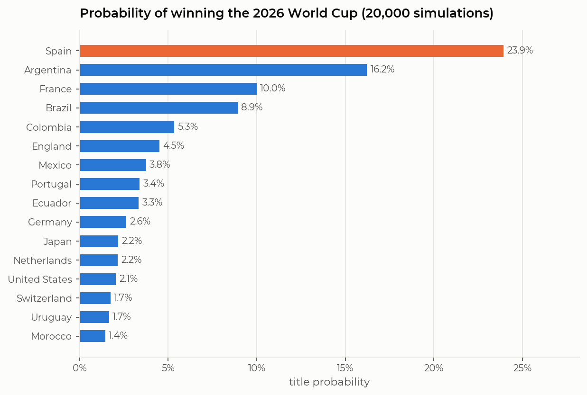
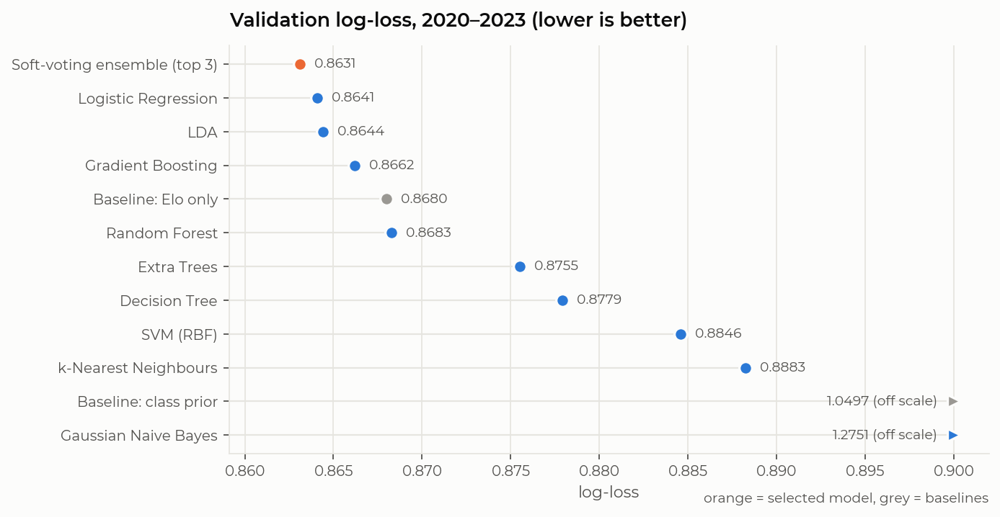

# Who wins the 2026 World Cup? A classical machine-learning forecast

This notebook forecasts the 2026 FIFA World Cup (USA, Canada & Mexico, 11 June to 19 July 2026) using **only data available on 1 June 2026**. It turns 150 years of international results into leakage-free match features, compares nine classical ML algorithms under a chronological validation scheme, keeps the best one, and simulates the 48-team tournament 20,000 times.

**Prediction: Spain, 23.9% to win the title**, ahead of Argentina (16.2%), France (10.0%) and Brazil (8.9%). The most likely final is Spain vs Argentina.



## How it works

**1. Data.** Every men's full international since 1872 (49,341 matches) and every penalty shoot-out, from [martj42/international_results](https://github.com/martj42/international_results). The snapshot in `data/raw/` is cut at 1 June 2026, and the notebook re-applies that cutoff every time it loads a file.

**2. Features** (21 per match, each computed only from earlier matches):
- an Elo rating computed in-house, with its home-advantage and K-factor parameters tuned by grid search on the training years;
- recent form (points per game over the last 5 and 10 matches), goals scored and conceded;
- strength of schedule (average opponent Elo), Elo momentum, rest days, experience;
- head-to-head record and match context (home or neutral venue, competition type).

**3. Validation design.** All splits are chronological, so the model never sees the future:

| Split | Period | Matches | Role |
|---|---|---|---|
| Train | 1994–2019 | 23,896 | fitting + hyper-parameter tuning with 5-fold `TimeSeriesSplit` |
| Validation | 2020–2023 | 3,505 | comparing algorithms, choosing the model |
| Test | Jan 2024 – May 2026 | 2,436 | one final, unbiased score |

**4. Models.** Logistic regression, LDA, Gaussian naive Bayes, k-NN, decision tree, random forest, extra trees, histogram gradient boosting and an RBF SVM, plus a soft-voting ensemble of the three best. Each is tuned on **log-loss**, because the simulation consumes probabilities rather than single picks. Every model is also compared against two baselines: the class prior, and an Elo-only model.

**5. Simulation.** The selected model produces win/draw/loss probabilities for every pairing (symmetrised at neutral venues; host nations get home advantage only in matches played in their own country). A Monte Carlo engine then plays the real format 20,000 times: 12 groups, the 8 best third-placed teams, FIFA's round-of-32 bracket, then extra time and penalties, with a shoot-out model fitted on historical shoot-outs.

## Results

| Model | Validation log-loss | Validation RPS | Validation accuracy |
|---|---|---|---|
| **Soft-voting ensemble (LR + LDA + GB)** | **0.8631** | **0.1685** | 61.2% |
| Logistic regression | 0.8641 | 0.1688 | 61.3% |
| LDA | 0.8644 | 0.1686 | 61.4% |
| Gradient boosting | 0.8662 | 0.1691 | 60.9% |
| *Baseline: Elo only* | *0.8680* | *0.1698* | *60.9%* |
| Random forest | 0.8683 | 0.1699 | 60.5% |
| SVM (RBF) | 0.8846 | 0.1725 | 60.7% |
| k-NN | 0.8883 | 0.1740 | 60.1% |
| *Baseline: class prior* | *1.0497* | *0.2289* | *47.9%* |

On the untouched **test set** the selected ensemble scores a log-loss of 0.858 and 60.5% accuracy, against 0.867 and 59.9% for the Elo-only baseline. Linear models beat the more flexible ones: with ~24,000 noisy football results, trees, kernels and neighbours mostly fit noise. Spain is the favourite under every one of the top models and under the Elo-only baseline, so the prediction does not depend on which algorithm is used.



Full per-team probabilities for every round are in [`outputs/wc2026_simulation.csv`](outputs/wc2026_simulation.csv).

## Run it

```bash
pip install -r requirements.txt
jupyter lab worldcup_2026_prediction.ipynb
```

A full run takes about 4–5 minutes on an 8-core laptop, mostly in the hyper-parameter search.

## Layout

```
worldcup_2026_prediction.ipynb   the whole pipeline: data → features → models → simulation
data/raw/                        results.csv, shootouts.csv (frozen at 1 June 2026)
figures/                         charts exported by the notebook
outputs/                         CV tuning, validation/test scores, simulation table, most likely bracket
```

## Limitations

Team strength is frozen on 1 June, with no squad news, injuries or in-tournament form, and there is no player-level data. The extra-time share is assumed, group tie-breakers are simplified, and third-placed teams are allocated by constraint matching rather than FIFA's exact table. Section 12 of the notebook covers these in detail.
